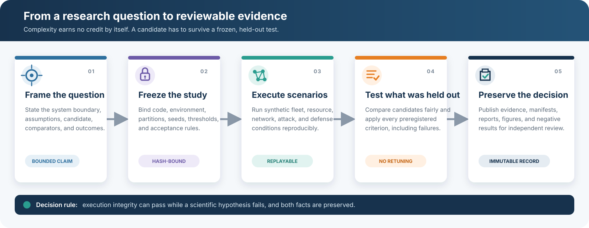
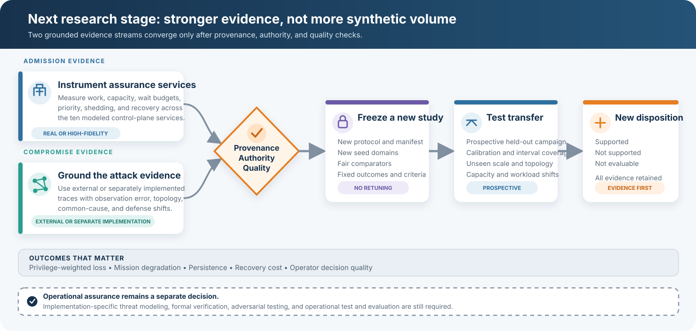

# Fleet Assurance Simulation

**An open research platform for testing what happens when fleets of software agents grow faster than the control, security, and recovery systems that support them.**

[Try the public playground](https://redxking.github.io/fleet-assurance-sim/) | [Quick start](QUICKSTART.md) | [Stage 3 report](paper/stage3_research_report.md) | [Successor protocol](docs/successor_prospective_protocol.md) | [Contributing](CONTRIBUTING.md)

Public repository: [github.com/redxking/fleet-assurance-sim](https://github.com/redxking/fleet-assurance-sim)

## What this project is

Fleet Assurance Simulation is a research software package for studying how modeled control-plane capacity, admission pressure, network structure, and compromise-response dynamics change as synthetic multi-agent fleets scale. It combines analytical checks, deterministic and stochastic simulation, preregistered experiments, replayable evidence, and offline visual review.

In this project, a *fleet* is a collection of cooperating software agents. Depending on the system being studied, those agents could represent autonomous services, decision agents, robots, sensors, or other distributed participants. The model does not assume that those very different systems are interchangeable. It provides a common experimental framework in which their assumptions can be stated and tested.

*Assurance* means more than whether the agents can exchange messages. A fleet also has to identify and authorize participants, issue and renew credentials, register tasks and telemetry, collect evidence, support supervision, revoke access, attest configuration, track dependencies, and recover when something fails. Every new agent adds useful capacity, but it also adds work and new paths through which failure or compromise can spread.

The practical question is:

> Can we recognize an approaching control or security limit early enough to make defensible admission, capacity, segmentation, and response decisions?

This repository turns candidate answers into executable models and tries to falsify them. Its outputs describe the implemented model under stated assumptions. They do not show that a real fleet is secure or ready to deploy.

## Try the public feedback MVP

The [Fleet Assurance Scenario Explorer](https://redxking.github.io/fleet-assurance-sim/) is the fastest way to use the project. It runs as a static browser experience and requires no account, installation, data upload, or telemetry. Choose or compare controlled scenarios across three fleet sizes, three admission profiles, and three capacity cases. Each cell summarizes 16 fixed-seed stochastic replications and includes a bounded representative time-series view. The resource capacities are provisioned in proportion to target fleet size before the capacity-case multiplier is applied, so cross-fleet views are not fixed-capacity scale-transfer tests. The displayed rates and means are descriptive samples without confidence, credible, prediction, or transfer intervals.

The explorer keeps projected assurance pressure separate from simulated operational outcomes. Projected pressure is an ex-ante model diagnostic, not a failure label, capacity recommendation, or security threshold. Every result is synthetic and model-conditioned.

- [Open the scenario explorer](https://redxking.github.io/fleet-assurance-sim/)
- [Report a bug or suggest an experiment](https://github.com/redxking/fleet-assurance-sim/issues/new/choose)
- [Review the public MVP scope and reproduction steps](docs/public_mvp.md)

## What the software does

The platform can:

- Build synthetic fleets with separate communication, authorization, dependency, and supervisory relationships.
- Model task flow, shared assurance services, queueing, capacity limits, admission bursts, missed deadlines, load shedding, and recovery.
- Simulate compromise attempts, propagation, common-cause events, detection, quarantine, revocation, segmentation, and timing disruption.
- Compare simple predictors with more detailed graph-based and phase-separated models on training, calibration, and held-out scenarios.
- Freeze protocols, source hashes, environments, seed domains, thresholds, and acceptance rules before a confirmatory execution.
- Preserve event logs, checkpoints, prediction records, manifests, reports, figures, and replayable visual evidence.

[](docs/assets/research-workflow.svg)

*The workflow keeps execution integrity separate from scientific support. A run can be complete and reproducible even when the hypothesis fails.*

## What Stage 3 found

Version 0.2.0 completed a hash-gated, five-block confirmatory evaluation of two model-conditioned candidates. The execution and evidence-integrity checks passed. The hypotheses did not.

| Track | Question | Confirmatory result | Engineering meaning |
|---|---|---|---|
| Stage 3A | Can projected pressure across ten assurance resources predict a separately calculated operational-failure label better than simpler measures? | Passed 10 of 12 criteria, but failed the required probability-calibration and 1.25-capacity-transfer checks. | Keep the projected overload measure as a diagnostic. Do not use its current mapping or threshold as an operational admission gate. |
| Stage 3B | Can a phase-separated dynamic message-passing model predict outbreak probability and final compromise better than selected simpler comparators? | Passed 5 of 13 criteria. Required improvement, interval, consistency, calibration-transfer, scale-transfer, and topology-transfer checks failed. | Keep phase separation and node-level state for research and inspection. Do not treat the tested predictor as operationally validated or superior. |

Under the preregistered all-criteria rules, both tracks are exactly `not_supported_under_preregistered_rule`. These are negative synthetic results, not operational validation.

That outcome is useful. It prevents two promising-looking research metrics from quietly becoming engineering requirements before they have demonstrated calibration and transfer. The complete interpretation, including the positive signals that did survive selected checks, is in the [Stage 3 research report](paper/stage3_research_report.md). The [publication figures](figures/stage3/) show where each candidate improved and where the fixed rules failed.

The evidence does **not** establish a universal Fleet Assurance Law, a secure fleet-size limit, a validated attack predictor, implementation security, or assurance for a 10,000-agent deployment. Stage 3 used synthetic data and no external operational validation.

## Where we are going

The next milestone is not a larger synthetic demonstration. It is a change in evidence quality.

[](docs/assets/research-roadmap.svg)

The admission branch will measure the ten modeled assurance services and test forecasts prospectively across capacity, architecture, and workload shifts. The compromise branch will use external or separately implemented traces, measured observation error, and more operationally meaningful outcomes. A separate synthetic implementation can test implementation dependence, but it is not external validation.

The successor engineering chain now reaches a target-free prediction commitment and realized-input binding. It accepts only public or synthetic campaign inputs, verifies authority and data-rights metadata, fits all ten resource models from calibration data only, applies explicit fit and uncertainty gates, and translates an accepted fit into ten simulator resource specifications through a no-fallback policy. Protocol version 1.1 freezes a distinct future campaign, the exact candidate and comparator estimators, interval construction, missing-data rules, metric formulas, and all-must-pass aggregation. It then generates every planned candidate and comparator prediction without accepting the future campaign as an input. The workflow remains engineering-only because simulator semantics are still aggregate approximations, the local commitment has no independently verified timestamp or custodian receipt, and outcome release, scoring, and scientific adjudication remain separate gates.

| Successor capability | Current state | What remains |
|---|---|---|
| Evidence intake | Implemented and fail-closed | Authorized measurements still require owner review and an approved collection plan. |
| Calibration and uncertainty gate | Implemented for engineering review | Thresholds and target ranges require scientific justification and registration before a prospective study. |
| Ten-resource adapter | Implemented, no fallback, runner authorization false | Resolve replay, service-time, disturbance-multiplier, retry, and closed-loop-control gaps; replace notional policy fields with evidence-backed values. |
| Prospective registration | Implemented as a closed seven-file package | Replace the engineering examples with justified numeric criteria, authorized nonsynthetic evidence, and an evidence-backed successor adapter. |
| Target-free prediction commitment | Implemented as a closed seven-file package | Obtain an independently verifiable receipt or timestamp before future collection; a local digest alone does not establish scientific pre-outcome custody. |
| Evaluation-input binding | Implemented as a closed three-file package | Bind the realized campaign to both the registration and prediction commitment, then add outcome-release custody before any scorer is considered. |

[](docs/assets/successor-evidence-chain.svg)

The historical held-out partition in the source campaign is verified for package integrity but never used to fit the model. The registration names a different future campaign and freezes its collection window, cells, time-block IDs, block timestamps, fleet sizes, admission counts, and observation windows with a declared timestamp ordered before collection. The prediction package generates a complete ten-resource prediction vector for every planned block without accepting the future campaign or target values. The evaluation-input manifest later binds the realized campaign to that commitment and requires exact block and predictor-design reconciliation. Local chronology checks do not prove package creation or publication time and are not external timestamp attestation; all packages keep scientific pre-outcome custody, execution, scientific use, and external validation false.

A separate [successor-study status view](docs/successor_status_ui.md) keeps those states visible without changing the frozen Stage 3 console. It can be generated locally from externally digest-bound evidence packages. The public scenario explorer does not publish successor-study evidence or imply successor readiness; publishing that status view remains a separate gated release decision.

The program will also strengthen interval coverage, retain strong simple comparators, expand cross-platform reproduction, and make evidence packages easier to review. Privilege-weighted loss, mission degradation, persistence, recovery cost, and operator decision quality will remain separate outcomes rather than being collapsed into one compromise fraction.

Any retuned model, revised threshold, new observation process, or changed acceptance rule belongs in a new preregistered study with a new manifest and execution directory. The completed Stage 3 record will remain immutable.

Deployment or fleet-size recommendations still require implementation-specific threat modeling, formal verification of critical components, adversarial testing, and operational test and evaluation.

## Start here

| If you want to... | Start with... |
|---|---|
| Try the project without installing anything | [Public scenario explorer](https://redxking.github.io/fleet-assurance-sim/) |
| Understand the project in five minutes | This README, then the [Stage 3 decision table](docs/stage3_research_decision_table.md) |
| Install and run one scenario | [QUICKSTART.md](QUICKSTART.md) |
| Inspect the confirmatory evidence | [Stage 3 evidence JSON](results/stage3/b8b6b320cb43a16ab0a12203ce63ec15e089fe8736c4849279a32093ffdd4851/stage3-confirmatory-20260819-01/stage3_evidence.json) |
| Review the scientific method | [Stage 3 preregistered protocol](docs/stage3_preregistered_protocol.md) and [architecture](docs/stage3_architecture.md) |
| See the main results | [Stage 3 figures](figures/stage3/) and [research report](paper/stage3_research_report.md) |
| Prepare successor-study evidence | [Empirical evidence intake and fit workflow](docs/empirical_evidence_intake.md) |
| Freeze or review the prospective evidence chain | [Successor prospective transfer protocol](docs/successor_prospective_protocol.md) |
| Review successor readiness | [Successor-study status UI](docs/successor_status_ui.md) |
| Reproduce or extend the work | [CONTRIBUTING.md](CONTRIBUTING.md) |
| Report a security issue | [SECURITY.md](SECURITY.md) |

## Five-minute local start

Python 3.11 or later is required. The frozen Stage 3 run used Python 3.13.0 and the package versions recorded in [requirements-stage3-freeze.txt](requirements-stage3-freeze.txt).

```bash
git clone https://github.com/redxking/fleet-assurance-sim.git
cd fleet-assurance-sim
chmod +x scripts/bootstrap.sh scripts/quick_demo.sh
./scripts/bootstrap.sh --dev --science
source .venv/bin/activate
python scripts/verify_local_install.py --tests --demo
```

Run one new notional scenario without changing retained evidence:

```bash
fleet-sim run \
  --config configs/baselines/mixed_100_visual.yaml \
  --output local_runs/general-v020-001 \
  --visualize
```

Launch the local multi-run console:

```bash
fleet-console --root .
```

It normally opens at `http://127.0.0.1:5006`. Windows, Docker, Conda, offline, and troubleshooting instructions are in [LOCAL_DEPLOYMENT.md](LOCAL_DEPLOYMENT.md).

Run the complete repository test suite before proposing a change. The exact verified count for this branch is recorded with each completed implementation handoff:

```bash
pytest -q
```

## Inspect the immutable Stage 3 evidence

The confirmatory execution is retained at:

```text
results/stage3/b8b6b320cb43a16ab0a12203ce63ec15e089fe8736c4849279a32093ffdd4851/stage3-confirmatory-20260819-01/
```

The public Git repository excludes the oversized generated Stage 3 HTML and JSON console exports. It includes the source and retained evidence required to rebuild them locally:

```bash
mkdir -p local_runs/stage3-consoles
fleet-stage3-console \
  --mode replay \
  --execution results/stage3/b8b6b320cb43a16ab0a12203ce63ec15e089fe8736c4849279a32093ffdd4851/stage3-confirmatory-20260819-01 \
  --output local_runs/stage3-consoles/stage3-confirmatory-20260819-01.html \
  --json-output local_runs/stage3-consoles/stage3-confirmatory-20260819-01.json
```

The builder reads the immutable execution and writes a new review copy under `local_runs`. It does not recompute the scientific result.

## Current evidence status

- All 151 frozen Stage 3 inputs matched their preregistered SHA-256 digests before execution.
- The completed execution manifest inventories 341 artifacts.
- Stage 3A retained 25,200 raw rows and 21,600 held-out predictions.
- Stage 3B retained 2,400 raw rows and 1,200 held-out predictions.
- Stage 3A is `not_supported_under_preregistered_rule`.
- Stage 3B is `not_supported_under_preregistered_rule`.
- All Stage 3 findings are synthetic and model-conditioned. No external operational dataset was supplied.

Earlier stages built and tested the analytical, simulation, replay, and falsification machinery used by Stage 3. Stage 2 also preserved negative findings against a single dynamic compromise score and a selected temporal scalar predictor. See the [Stage 2 research report](paper/stage2_cycles5_to7_research_report.md) for that history.

## Architecture at a glance

The repository has three connected layers:

1. **Simulation core:** agents, tasks, event scheduling, deterministic random substreams, communication and authorization graphs, queueing, compromise, defense, timing, credential, and recovery events.
2. **Research models:** queueing and scalability analytics, the ten-resource assurance-admission network, graph and temporal compromise predictors, phase-separated estimation, comparators, calibration, bootstrap intervals, and transfer tests.
3. **Evidence system:** frozen protocols and manifests, atomic checkpoints, event and prediction records, replay verification, reports, figures, decision tables, and offline consoles.

Supported graph families include complete, random regular, Erdos-Renyi, Barabasi-Albert, and hierarchical topologies. Segmentation options include partitions, gateways, and degree caps. The simulator also includes bounded synthetic shared-image common-cause and Sybil-admission mechanisms. Broader adaptive-adversary, Byzantine, insider, package-lineage, and instruction-manipulation models remain future work.

Detailed interfaces and assumptions are documented in [docs/architecture.md](docs/architecture.md) and [docs/stage3_architecture.md](docs/stage3_architecture.md).

## Repository layout

```text
configs/                Scenario, parameter, and research-protocol configuration
docs/                   Architecture, decisions, traceability, and user guidance
figures/                Generated publication figures and provenance
manifests/              Frozen environment, execution, and release records
paper/                  Research and verification reports
replay_bundles/         Small retained demonstrations and Stage 2 console
results/                Machine-readable metrics, evidence, and synthesis
scripts/                Reproducible entry points and release tooling
src/fleet_sim/          Simulation, models, analysis, and visualization code
tests/                  Unit, statistical, replay, integration, and visual checks
```

## Evidence map

- [Stage 3 research report](paper/stage3_research_report.md): complete interpretation, methods, threats to validity, and recommendations
- [Stage 3 machine-readable synthesis](results/stage3_synthesis/stage3_synthesis.json): compact result and provenance record
- [Stage 3 evidence ledger](results/stage3_synthesis/evidence_ledger.csv): claims mapped to evidence and disposition
- [Stage 3 decision table](docs/stage3_research_decision_table.md): engineering decisions in readable form
- [Stage 3 figures](figures/stage3/): publication images with a [checksum manifest](figures/stage3/figure_manifest.csv) and [provenance record](figures/stage3/figure_provenance.json)
- [Preexecution manifest](manifests/stage3_preexecution_manifest.json): frozen protocol identity, files, environment, command, and seed domains
- [Confirmatory evidence](results/stage3/b8b6b320cb43a16ab0a12203ce63ec15e089fe8736c4849279a32093ffdd4851/stage3-confirmatory-20260819-01/stage3_evidence.json): exact criteria and dispositions
- [Execution manifest](results/stage3/b8b6b320cb43a16ab0a12203ce63ec15e089fe8736c4849279a32093ffdd4851/stage3-confirmatory-20260819-01/execution_manifest.json): final artifact inventory
- [Requirements traceability matrix](docs/requirements_traceability.csv): requirement-to-artifact coverage
- [Data dictionary](docs/data_dictionary.md): fields, semantics, and evidence boundaries

## Reproducibility and interpretation

The Stage 3 protocol, source closure, environment, partitions, seeds, thresholds, and criteria were frozen before the confirmatory execution. Engineering pilots were excluded from scientific adjudication. The retained confirmation must not be overwritten or silently retuned.

The public repository is a curated collaboration surface. It contains source, protocols, tests, reports, figures, compact syntheses, and the immutable synthetic confirmation needed for review. It excludes virtual environments, caches, engineering-pilot outputs, oversized generated consoles, local scratch data, and the complete local release ZIP. See [docs/public_repository_scope.md](docs/public_repository_scope.md).

A simulation establishes how the implemented model behaves. A modeled design point that violates a correctly applied constraint is ruled out only for that model and assumption set. Passing a model check does not validate a real system.

## Contributing

Contributions are welcome in reproducibility, empirical calibration, separate attack-trace implementations, statistical review, model extensions, security, correctness, performance, accessibility, visualization, and documentation.

Start with [CONTRIBUTING.md](CONTRIBUTING.md). Changes to a frozen scientific model, comparator, threshold, outcome, or acceptance rule must be proposed as a new study rather than written into the completed confirmation. Do not submit proprietary, classified, export-controlled, personal, operationally sensitive, or third-party restricted data.

Security issues should be reported through the private process in [SECURITY.md](SECURITY.md), not through a public issue.

## License and citation

The software is released under the [Apache License 2.0](LICENSE). Citation metadata is provided in [CITATION.cff](CITATION.cff).
