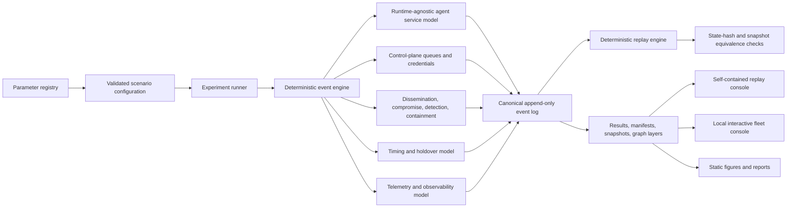

# Fleet Assurance Simulation Architecture

## Purpose

This repository is the first executable increment of the version-zero strawman for formal and visual simulation of secure multi-agent fleet scaling. The architecture keeps the scientific model, experiment orchestration, analysis, replay, and visualization separate so that each can be verified independently.

The current implementation is a Stage 0 foundation. It verifies known analytic regimes, deterministic execution, immutable event capture, replay equivalence, and an integrated visual scenario. It does not establish that any deployed multi-agent fleet is secure.

## Logical architecture

## Primary components

### Configuration and provenance

`fleet_sim.config.SimulationConfig` validates one immutable scenario and produces a deterministic configuration hash and run identifier. `configs/parameters/registry.yaml` classifies parameters as analytically fixed, measured, inferred, notional, or conjectured. The current integrated scenarios are notional.

### Deterministic event kernel

`fleet_sim.model.engine.DeterministicEventEngine` uses simulation time, event priority, and insertion sequence to resolve all ordering. Randomness is isolated into named NumPy PCG64DXSM substreams. Given the same code, configuration, seed, and environment, the event sequence is deterministic.

### Runtime-agnostic agent boundary

`fleet_sim.model.agent.Agent` exposes identity, authorized capabilities, opaque state label, stochastic service rate, telemetry rate, and kill-authority endpoint. The simulator does not inspect or depend on the internal realization of the agent policy.

### Fleet graph layers

The current integrated simulator maintains separate communication and authorization graphs. Five topology families are implemented: complete, random regular, Erdos-Renyi, Barabasi-Albert, and hierarchical tree. Segmentation can remove cross-partition edges, create constrained gateways, or cap degree.

Dependency, supervisory, and time-varying attack-reachability graphs remain separate planned layers. They must be added before broad security claims are permitted.

### Control plane

The authorization control plane is modeled as a multi-server service center. The analytic baseline includes M/M/1, M/M/c, Erlang C, utilization, Little's Law consistency, and server sizing for a target utilization. Credential renewal and mass revocation create explicit event and queue load.

Control-plane replication is represented in configuration and reporting. Consensus between control-plane replicas is not yet coupled into the integrated event path.

### Security process

The current integrated security process is a finite, stylized SIR-like sequence that emits compromise, boundary traversal, detection, quarantine, revocation, and recovery events. Separate modules provide SIS, SIR, gossip, spectral-radius diagnostics, and bond-percolation distributions.

The current epidemic threshold output is a model-specific diagnostic. It is not treated as a universal exact threshold for finite stochastic systems.

### Replay and integrity

Every state-changing event is written to canonical JSONL. Selected integrity checkpoints carry before and after state hashes. `ReplayEngine` rebuilds the final state, verifies declared checkpoints, generates snapshots, and verifies snapshot-plus-delta seek. Publication is blocked if the replay state hash differs from the simulation state hash.

### Visualization

Two visual paths are implemented:

1. A self-contained HTML replay console generated from the canonical event bundle. It requires no network access and supports event playback, stepping, topology-layer toggles, node inspection, and synchronized operational plots.
2. A local Bokeh console with Replay, Comparison, Scenario, and Live-capture modes. The current Live mode executes an immutable run and then autoplays its captured event stream. True event streaming during execution remains planned.

The visualization consumes stored event and graph artifacts. It does not calculate scientific metrics from screen geometry or animation state.

## Physical deployment mapping

The simulation is runtime-agnostic and deployment-agnostic. A physical implementation can map the model onto containers, virtual machines, serverless workers, hardware controllers, human-operated APIs, or mixed fleets. The model boundary requires externally observable service behavior, workload identity, capability scope, telemetry behavior, and a kill-authority interface.

## Assurance boundaries

The current enforcement boundary is the authorization graph plus credential state. The future attack-reachability graph must compose communication reachability, authorization reachability, shared dependencies, administrative authority, common images, identity infrastructure, and scenario-specific exploit preconditions.

## Current known limitations

The current segmentation function is structural and intentionally simple. Some partition choices can fragment hierarchical authorization graphs more aggressively than an operational design would. It is suitable for software verification and threshold exploration, but not yet a reference segmentation algorithm.

The integrated workload uses exponential interarrival and service processes with notional rates. Coalition formation, correlated supply-chain compromise, Byzantine behavior, Dolev-Yao message manipulation, Sybil admission pressure, partial synchrony, CRDT state size, rate-distortion anomaly loss, supervisory controller dynamics, and rare-event importance sampling remain future increments.
