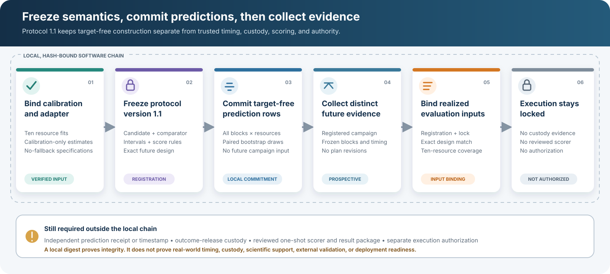

# Empirical assurance evidence intake

## Purpose

This successor-study component turns a candidate assurance-resource measurement campaign into a portable, checksum-bound review package. A separate calibration gate can then estimate a bounded aggregate arrival model from the verified calibration partition and report whether its engineering criteria passed, failed, or could not be evaluated. Neither step runs a scientific experiment, alters the completed Stage 3 evidence, authorizes the existing runner, or establishes external validation.

The intake asks whether the campaign is sufficiently described and internally consistent to enter engineering review. The fit gate asks whether the calibration partition has enough support, identifiability, fit quality, stability, and uncertainty precision for a later adapter review. A preregistered protocol must still justify the thresholds, define operational outcomes and comparators, separate future held-out custody, and freeze transfer and scientific acceptance rules before evaluation.

## Evidence boundary

The campaign manifest records:

- a portable campaign, site, and system alias;
- collection start and end times;
- collection authority and data-rights references;
- allowed research uses;
- instrumentation, clock, sampling, window, missingness, censoring, and transformation semantics;
- an exact unit contract for every retained measurement.

The current implementation accepts only `public` and `synthetic` classifications. It intentionally rejects internal and controlled data because this package writer does not implement an approved secure-storage, encryption, retention, or export-control policy.

Nonsynthetic rows require affirmative collection authorization, confirmed data rights, a nonsynthetic classification, and an instrumentation quality review. Those fields are supplied by the campaign owner and remain unreviewed assertions at intake. For that reason, measured and replayed packages remain labeled `*_input_unreviewed`, `external_validation` remains `false`, and `scientific_use_authorized` remains `false`.

## Partition and resource rules

Every campaign must contain prospective `calibration` and `heldout` partitions. The word `heldout` is the successor intake spelling; any later adapter to a Stage 3A-style API must translate it explicitly to `held_out`.

Each `time_block_id` is one contemporaneous ten-resource observation vector:

- exactly one observation for each implemented assurance resource;
- one aligned timestamp and one window duration;
- one partition only;
- stable resource identifiers across all blocks and both partitions.

Observation windows are treated as half-open intervals. All calibration windows must finish no later than the first held-out window begins. For `fixed_nonoverlapping` campaigns, a window cannot exceed the declared sampling interval and windows for the same resource cannot overlap.

Rows with censoring or nonzero missingness can be retained for review, but the quality report identifies the required policy work. The current calibration estimator rejects both conditions. Every package remains blocked from scientific use until a successor protocol and a documented fit review authorize a narrower use.

## Package workflow

Start from:

- `examples/empirical_assurance_campaign_template.json`
- `examples/empirical_assurance_measurements_template.csv`

Then create a new package:

```bash
python scripts/package_assurance_campaign.py \
  path/to/measurements.csv \
  path/to/campaign.json \
  local_runs/empirical-campaign-001
```

The destination must not exist. The command writes exactly seven regular local files:

| Artifact | Purpose |
|---|---|
| `campaign_manifest.json` | Canonical authority, instrumentation, units, and campaign metadata |
| `campaign_schema.json` | Trusted closed schema used for campaign metadata validation |
| `calibration_measurements.parquet` | Canonical calibration partition |
| `heldout_measurements.parquet` | Canonical prospective held-out partition |
| `measurement_schema.json` | Trusted closed schema used for measurement validation |
| `quality_report.json` | Counts, coverage, missingness, censoring, and fit-blocking status |
| `evidence_manifest.json` | Source, schema, implementation, runtime, transformation, partition, artifact, and self-integrity hashes |

The command prints the SHA-256 digest of `evidence_manifest.json`. Record that digest in an external, access-controlled study ledger if later verification must be bound to a value held outside the mutable package. The self-integrity hash inside the package detects accidental inconsistency; it is not a signature and does not authenticate origin.

The package does not retain the raw source file. It records only the source basename and SHA-256 digest, while the normalized partition artifacts carry the retained data. Raw measurements must remain under their owner-approved custody and retention controls.

## Calibration fit gate

The fit gate consumes the campaign package only after its `evidence_manifest.json` digest has been supplied from outside that package. Source-package verification reads and validates both retained partitions before the fit begins. The verified API then projects only the calibration frame into the estimator; held-out values are not fit inputs. The fit records `source_package_heldout_verified=true` and `heldout_used_for_fit=false` so verification access is not confused with statistical use. The fit identity is derived from the calibration content, calibration-derived source classification, campaign context that is invariant to held-out values, trusted schemas, policy, and implementation. The combined campaign dataset identifier and held-out content commitment remain provenance records and are not fit-identity inputs.

The implemented model is

```text
arrival_rate = background_work_per_agent_s * fleet_size
             + admission_work_units_per_agent * admission_rate
```

The coefficients are fitted with duration-weighted nonnegative least squares. Capacity, service-time window summaries, deadline-derived maximum wait, and drop/defer fractions are retained as descriptive summaries. They are not silently treated as fitted queue behavior.

Uncertainty uses a joint circular moving-block bootstrap over ordered calibration time blocks. Every valid bootstrap replication uses the same sampled block sequence for all ten resources, preserving contemporaneous cross-resource dependence. The retained package includes the block-sequence digest and every successful draw.

The closed policy covers:

- minimum time blocks and observations per resource;
- fleet-size, admission-rate, zero-admission, active-admission, and joint-predictor support;
- full-rank and scaled-condition-number requirements;
- marginal target-range coverage and joint fleet-size/admission-rate convex-hull
  coverage, with extrapolation treated as failure;
- weighted normalized RMSE, relative bias, and weighted R-squared;
- capacity and deadline stability;
- joint-bootstrap success and percentile interval widths;
- a strictly positive lower interval bound for admission work;
- positive completed-service support and positive service-time summaries for
  completed work; and
- complete, uncensored calibration rows.

The implementation also caps bootstrap requests at 10,000 replications and
10,000,000 deterministic work units across replications, calibration blocks,
and resources. Requests beyond either bound are rejected before fitting.

The shipped policy is [`configs/successor/empirical_calibration_policy.json`](../configs/successor/empirical_calibration_policy.json). It is an explicit engineering draft used to exercise the gate. Its numerical thresholds and target range have not been scientifically justified or preregistered and must be reviewed and frozen before a prospective collection. Changing the policy changes its SHA-256 and the calibration-fit identity.

Run the gate with the externally recorded digest printed by the campaign packaging command:

```bash
python scripts/fit_empirical_assurance_calibration.py \
  local_runs/empirical-campaign-001 \
  local_runs/empirical-calibration-fit-001 \
  --expected-campaign-evidence-manifest-sha256 <64-lowercase-hex-digest>
```

The output directory must not exist. The command writes and then independently verifies exactly seven files:

| Artifact | Purpose |
|---|---|
| `calibration_measurements.parquet` | Exact calibration partition bound to the source campaign |
| `calibration_policy.json` | Canonical policy used for the fit and gates |
| `calibration_policy_schema.json` | Retained closed policy schema |
| `calibration_fit.json` | Estimates, intervals, diagnostics, criteria, and dispositions for all ten resources |
| `calibration_fit_schema.json` | Retained closed-shape fit schema |
| `bootstrap_draws.parquet` | Successful joint moving-block bootstrap draws |
| `fit_evidence_manifest.json` | Source commitments, fit bindings, artifact inventory, and self-integrity hash |

The command prints the fit evidence-manifest SHA-256. At creation time, `fit_evidence_manifest_externally_digest_bound` is therefore `false`. Record the digest in a separate study ledger and supply it during a later verification or registration step to establish that binding. As with the intake digest, a hash is not a signature or proof of origin.

### Fit dispositions

Every global criterion, resource criterion, resource, and overall fit uses one of three states:

- `passed`: the declared engineering threshold was satisfied;
- `failed`: the result contradicted a declared threshold;
- `not_evaluable`: the data or valid bootstrap support was insufficient to make the comparison.

`interface_verification_ready` becomes true only when every gate passes. `eligible_for_adapter` additionally requires `study_mode=successor_transfer` and nonsynthetic calibration input. These flags still leave `runner_authorized`, `scientific_use_authorized`, and `external_validation` false.

The synthetic campaign template contains two time blocks and 20 resource observations. It is expected to fail the overall engineering-draft gate because its target coverage is inadequate, while its resource fits remain `not_evaluable` because the design and bootstrap support are insufficient. It demonstrates interfaces and integrity behavior; it is not adequate calibration evidence.

### Current modeling limitations

The fit does not identify arrival-process family, service-time distribution, overload behavior, shedding threshold, or recovery capacity multiplier. Those fields require additional measurement semantics, controlled workload coverage, or an explicit future adapter policy.

`service_time_between_window_standard_deviation_ms` describes variation among aggregate window summaries. It is not an individual-request service-time distribution. The current aggregate simulator also does not consume `service_time_mean_ms`, does not perform true trace replay for `empirical_replay`, and maps multiple service-distribution enum values onto the same completion-count behavior. For those reasons, even a passing fit does not authorize the current runner or support a higher-fidelity transfer claim.

The current intake package contains both calibration and held-out partitions. The estimator is code-level calibration-only, but the source verifier necessarily checks both partitions. A genuinely prospective protocol therefore needs procedural separation: register the fit and prediction contract before future held-out collection, or place held-out evidence under separate custody until the prediction commitment is frozen.

## Assurance-resource adapter

The adapter turns an externally digest-bound, accepted calibration-fit package into exactly ten `AssuranceResourceSpec` objects. It does not refit coefficients, inspect held-out values, fill missing fields, authorize the existing runner, or promote the evidence scope.

The adapter maps:

- fitted background work and admission work from their accepted point estimates;
- capacity from either its accepted point or lower interval bound, as frozen by policy;
- the aggregate service-time window mean as a retained specification value;
- maximum wait from the accepted point or lower interval bound after the policy declares the deadline field to be a maximum queue-wait budget;
- arrival-count, completion-count, overload, shedding-threshold, and recovery behavior from explicit per-resource policy entries.

Every policy-supplied field needed to construct the current base resource specifications has a `configured`, `inferred`, or `notional` evidence class and a portable reference. The adapter has no default or fallback path. A `successor_transfer` policy containing even one notional field is rejected. Simulator controls outside `AssuranceResourceSpec` remain explicit limitations rather than implied policy coverage.

The current aggregate implementation supports only these deliberately named adapter modes:

- `poisson_count` or `deterministic_expected_count` for arrivals;
- `deterministic_completion_count`, `poisson_completion_count`, or `gamma_completion_count` for service completions.

`poisson_completion_count` maps to the legacy `ServiceTimeDistribution.EXPONENTIAL` enum even though the simulator draws a Poisson completion count. True empirical arrival and service replay are not exposed by the adapter because the current simulator does not implement them.

The current simulator also applies fixed per-resource workload multipliers for Sybil attempts, mass restart, and mass renewal. Its closed-loop admission thresholds and deferred-work retry fraction are fixed in the legacy simulator. The current measurement schema does not identify those values, and the adapter policy does not bind them. They must be exposed as reviewed policy or calibrated from richer evidence before successor-run authorization can be considered.

### Interface example policy

[`configs/successor/assurance_resource_adapter_policy.example.json`](../configs/successor/assurance_resource_adapter_policy.example.json) is an interface-verification example, not a transfer policy. It:

- permits only `synthetic_or_mixed_interface_only` fit evidence;
- covers all ten template resource identifiers;
- marks every policy-controlled field as notional;
- binds the engineering-draft fit policy semantic SHA-256 `dc887ba249064ae8489de41bcf0ba05a1fff454793f4daad70aad89843212e09`;
- binds the current aggregate simulator SHA-256 `d5c955972307ee9e9077073dde775c2505effaeb18c13f0cb0a5a0acc64d1f32`.

The example policy semantic SHA-256 is `cdacb4012e9f190f8110645a0bcf8cd52108ff896085d5c81a82cdffd3f874df`. This is the SHA-256 of its canonical semantic JSON, not necessarily its formatted file bytes. Any policy or bound implementation change must produce and externally record a new expected digest.

The two-row synthetic intake template cannot reach this adapter because its fit gate fails. The example policy is intended for a sufficiently supported synthetic interface campaign whose ten resource fits all pass the interface-verification gate.

Build an adapter package only after separately recording the campaign, fit, and policy digests:

```bash
python scripts/build_assurance_resource_specs.py \
  local_runs/empirical-campaign-001 \
  local_runs/empirical-calibration-fit-001 \
  local_runs/assurance-resource-adapter-001 \
  --expected-campaign-evidence-manifest-sha256 <campaign-digest> \
  --expected-fit-evidence-manifest-sha256 <fit-digest> \
  --expected-adapter-policy-sha256 cdacb4012e9f190f8110645a0bcf8cd52108ff896085d5c81a82cdffd3f874df
```

The command verifies and deterministically recomputes the fit, loads the adapter policy against the externally supplied semantic digest, generates the ten specifications, writes the package, and independently recomputes the adapter result. The destination must not exist.

The package contains exactly five files:

| Artifact | Purpose |
|---|---|
| `adapter_policy.json` | Canonical no-fallback mapping policy |
| `adapter_policy_schema.json` | Retained closed-shape policy schema |
| `assurance_resource_specs.json` | Exactly ten generated resource specifications |
| `assurance_resource_specs_schema.json` | Retained closed-shape specification schema |
| `adapter_manifest.json` | Fit, policy, implementation, simulator, specification, field-provenance, limitation, and artifact bindings |

At creation time, `adapter_manifest_externally_digest_bound` is `false`. Record the printed `adapter_manifest_sha256` in the successor registration ledger and supply it during later verification to create an external integrity binding. The adapter manifest always records:

- `source_package_heldout_verified=true`;
- `heldout_used_for_adapter=false`;
- `no_fallback=true`;
- `external_validation=false`;
- `scientific_use_authorized=false`;
- `runner_authorized=false`;
- `scientific_use=engineering_simulation_only`.

A generated specification package is therefore an inspectable engineering artifact, not an execution authorization, operational configuration, fleet-size recommendation, or external-validation result.

## Prospective registration and evaluation-input binding

The next evidence boundary is now implemented as a two-manifest protocol. See the [successor prospective transfer protocol](successor_prospective_protocol.md) for the complete commands, package inventories, schemas, and library APIs.

[](assets/successor-evidence-chain.svg)

The distinction between the two held-out concepts matters:

- The source campaign's historical held-out partition is verified as part of package integrity, but `heldout_used_for_fit=false` and `heldout_used_for_adapter=false` remain enforced.
- The registration names a different future evaluation campaign and freezes its collection window, cells, time-block IDs, block timestamps, fleet sizes, admission counts, and observation-window durations before collection begins.
- The evaluation-input binder runs after collection and requires the realized campaign identity, window, block set, predictor design, and ten-resource coverage to reconcile exactly to the registration.

`scripts/freeze_successor_registration.py` creates the seven-file registration package. It binds the externally recorded source-campaign, fit, adapter-policy, and adapter-manifest digests to the registered plan, transfer contract, closed schemas, and implementation hashes. `scripts/bind_successor_evaluation_inputs.py` then creates a separate three-file package that binds the externally recorded registration digest and realized campaign digest.

The only implemented transfer target is ten-resource `resource_arrival_rate_transfer`, using the frozen aggregate arrival-rate formula and duration-weighted normalized RMSE, absolute duration-weighted relative bias, and background-only relative-improvement metrics. The engineering example leaves numerical thresholds null rather than presenting unreviewed values as scientific criteria. A prospective contract requires complete numeric thresholds, a passing `successor_transfer` fit, a `successor_transfer` adapter, nonsynthetic calibration evidence, and no notional adapter fields.

Operational-outcome transfer is explicitly disabled. The protocol does not score mission outcomes, security events, privilege-weighted loss, recovery cost, or deployment readiness.

Both packages check that local registration precedes the planned and realized collection windows, but they record `registration_time_externally_attested=false`. This is an internal chronology check, not trusted timestamping, a signature, or proof of external receipt.

After evaluation-input binding, the chain still records:

- `prediction_rows_preoutcome_locked=false`;
- `outcome_release_custody_verified=false`;
- `execution_chain_ready=false`;
- `external_validation=false`;
- `scientific_use_authorized=false`; and
- `runner_authorized=false`.

The retained evaluation campaign already contains `arrival_count`, and its package verifier reads that artifact. This step is therefore not a preoutcome blind. It records that prediction rows were not committed before target access and that outcome-release custody is unverified, which keeps execution blocked.

The next implementation slice is an independent preoutcome prediction commitment and outcome-release custody gate, followed by a separately reviewed one-shot scorer and immutable result package. It must not reuse or modify the frozen Stage 3 runner or evidence.

No fleet-size, deployment, security-assurance, scientific-support, or external-validation recommendation should be derived from an intake, fit, adapter, registration, or evaluation-input package alone.
